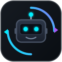

<p align="center">
  
</p>

# OpenCode Models for Copilot (`opencode-copilot-sync`)

[](https://github.com/mfenderov/opencode-copilot-sync/actions/workflows/ci.yml)
[](scripts/crap-report.mjs)
[](LICENSE)
[](https://github.com/mfenderov/opencode-copilot-sync/releases)

A lightweight VS Code extension that automatically synchronizes model catalogs from **OpenCode Go** and **OpenCode Zen** into GitHub Copilot in VS Code under a **single unified provider** with **smart cost-optimized routing**. Its HTTP client is bundled into the extension package.

---

## ✨ Features

- **Unified model catalog:** Automatically syncs OpenCode Go and Zen models under one **OpenCode** provider, preferring the Go flat subscription when a model is covered.
- **Secure credentials:** Stores API keys in VS Code's encrypted SecretStorage and supports `OPENCODE_API_KEY` for automation.
- **Lean chat adapter:** Registers enriched models with VS Code, adds OpenCode's required conversation header, and delegates protocol encoding and stream parsing to the official provider SDKs.
- **Usage at a glance:** Shows Go subscription quotas and reset timers in the OpenCode sidebar.
- **Safe mirroring:** Preserves unrelated providers and destination-local secrets when syncing VS Code profiles and the associated WSL distro.

---

## 🚀 Quick Install

### Install from the VS Code Marketplace (Recommended)

Search for **OpenCode Models for Copilot** in the Extensions view, or run:

```bash
code --install-extension mfenderov.opencode-copilot-sync
```

For a manual install, download a `.vsix` from the [Latest Release](https://github.com/mfenderov/opencode-copilot-sync/releases/latest) and choose **Install from VSIX...** in the Extensions view.

### Build from Source

```bash
git clone https://github.com/mfenderov/opencode-copilot-sync.git
cd opencode-copilot-sync
npm ci
npm run package
code --install-extension opencode-copilot-sync-*.vsix
```

### Dependencies

- This local spike targets VS Code `1.142` or later (the latest stable version at build time).
- Building, testing, and packaging from source requires Node.js and npm. `npm ci` installs the locked runtime and development dependencies, including `undici` and the build/test tools.
- `npm run package` bundles the HTTP client into the VSIX; end users do not need to install a separate runtime package.

---

## ⚙️ Configuration Settings

Customize behavior via VS Code Settings (`Cmd+,` / `Ctrl+,` search for `opencode`):

| Setting | Default | Description |
| :--- | :--- | :--- |
| `opencode.autoSyncOnStartup` | `true` | Automatically sync models on VS Code launch or window reload. |
| `opencode.includeGoModels` | `true` | Include models from the OpenCode Go subscription catalog. |
| `opencode.includeZenModels` | `true` | Include OpenCode Zen catalog models as announced upstream. |
| `opencode.additionalSyncTargets` | `[]` | Additional absolute `chatLanguageModels.json` paths to mirror to. Use this to opt in to another user profile or a sibling WSL distro. |

---

## 🕹️ Commands, Status Bar & Sidebar

- **Activity Bar View**: Click the **OpenCode** hubot icon in the left Activity Bar to see:
  - 📊 Real-time Go subscription quotas (rolling 5-hour, weekly, monthly limits & reset timers)
  - 🏷️ Active model counts (OpenCode Go flat-rate vs OpenCode Zen)
  - ⚡ Quick actions to sync models, update API key, and open config
- **Status Bar Indicator**: Click `$(hubot) OpenCode` in the bottom-right status bar to trigger a live sync with spin animation.
- **Command Palette** (`Cmd+Shift+P` / `Ctrl+Shift+P`):
  - `OpenCode: Sync Models to Copilot`: Manually fetch models and refresh Copilot.
  - `OpenCode: Refresh Usage`: Refresh Go subscription limits in status bar and sidebar view.
  - `OpenCode: Set API Key`: Update your OpenCode API key securely.
  - `OpenCode: Open Copilot Models Config`: Open `chatLanguageModels.json` in editor.

---

## Model registration and chat transport

The extension fetches the Go and Zen catalogs, enriches models with metadata, and registers them under the native **OpenCode** provider. The last synced catalog is cached for reloads. The primary profile's old OpenCode Custom Endpoint entry is removed to avoid offering a duplicate path that cannot supply conversation headers; unrelated providers and optional profile mirrors are preserved.

A small adapter adds `x-opencode-session`, translates VS Code message parts to SDK messages, and forwards SDK response parts. It does not compact or truncate history, set idle timers, replay failed requests, or implement automatic retries. Cancellation comes from VS Code. The official OpenAI and Anthropic provider SDKs handle wire formats and stream parsing.

Where VS Code supplies `modelOptions._conversationId`, that ID is used unchanged. Current stable Agents sessions require the approved history-based fallback: bounded message-hash chains and UUIDs are persisted, without message text. Identical histories cannot be distinguished until they diverge; truncated or rewritten history can also lose continuity. This is an approximation, not an exact host session identity. It is not a profile-wide shared UUID. Responses requests send full history with `store: false` and no `previous_response_id`.

Go and Zen models remain subject to OpenCode's access restrictions; this extension does not bypass them.

## 🪟 Windows & WSL Usage

- The active extension stores its API key in that VS Code extension host's encrypted `SecretStorage`. An explicitly supplied `OPENCODE_API_KEY` environment variable is also supported (commonly for CI); the extension and E2E tests do not scan OpenCode `auth.json` files.
- Automatic compatibility targets are limited to the current OS user's existing VS Code profiles and the WSL distro explicitly associated with the current VS Code remote window. Other user homes and sibling distros are not discovered. Add exact absolute config-file paths to `opencode.additionalSyncTargets` to opt in to more targets.
- A compatibility mirror never receives the extension's raw API key. VS Code resolves custom endpoint keys through a target-local SecretStorage reference such as `${input:chat.lm.secret.<id>}`. A profile without its own VS Code-generated reference is skipped and reported in the **OpenCode Copilot Sync** output channel. To enable that mirror, configure OpenCode in that profile through **Manage Language Models** and enter the key there; the next sync will preserve and reuse that profile's reference.

### Remote-SSH, Dev Containers & GitHub Codespaces

The extension's `extensionKind: ["ui", "workspace"]` setting asks VS Code to activate it on the same host as Copilot Chat in every remote topology, so Remote-SSH, Dev Containers, and Codespaces are expected to work the same way as WSL. These topologies aren't part of the automated test matrix yet (only WSL is), so treat them as **best-effort**: if sync doesn't pick up your models, run **`OpenCode: Sync Models to Copilot`** manually and check the **OpenCode Copilot Sync** output channel (`View → Output → OpenCode Copilot Sync`) for the logged `Remote: <name>` line, which confirms which host the extension actually activated on.

### Known limitation: Agents window under Remote-WSL

OpenCode models show up correctly in **Manage Language Models** and work fine in the regular **Copilot Chat view** under Remote-WSL. However, they currently do **not** appear in the model picker inside the **Agents window** (the standalone agentic session UI) when the workspace is opened via Remote-WSL.

This is a confirmed upstream VS Code limitation, not a bug in this extension: under Remote-WSL, the Agent Host process communicates over a remote path where the BYOK (Bring-Your-Own-Key) bridge is currently hardcoded as unavailable, regardless of which extension registers the model. It affects **every** BYOK/custom-endpoint provider under WSL, not just OpenCode. Tracked upstream in [microsoft/vscode#332085](https://github.com/microsoft/vscode/issues/332085) — a VS Code team member confirmed "Support for WSL is added to the backlog," with no ETA. Plain Windows and Dev Containers are unaffected.

---

## 🛠️ How It Works Under the Hood

The extension registers the native **OpenCode** provider through a thin SDK adapter and maintains optional `chatLanguageModels.json` mirrors for profile compatibility. Unrelated providers are preserved, and raw API keys are never copied between profiles. Protocol classification and catalog enrichment remain separate from this transport experiment.

---

## Troubleshooting repeated progress messages or premature stops

Check **View → Output → OpenCode Copilot Sync** for catalog-fetch and registration errors, and VS Code's Copilot logs for request failures. If models are missing, run **OpenCode: Sync Models to Copilot** and select a model under the native OpenCode provider, not the headerless Custom Endpoint experiment.

The original premature-stop cause remains unconfirmed. This local spike removes the old custom stream/recovery implementation so its behavior can be compared with SDK-managed streaming; successful registration and mock requests do not prove live-stream reliability.

---

## CI & Releases

CI runs lint, coverage, complexity checks, tests, and packaging on pull requests and pushes to `main`. On `main`, the quality job also commits refreshed CRAP badges. After the checks pass, the release job fast-forwards its checkout to include that badge commit before bumping the version and pushing the release tag. It never force-pushes; divergent history stops the release. The release job then dispatches the GitHub release and Marketplace publishing workflow for that tag.

The release synchronization regression tests use disposable local Git repositories and run with `node --test test/ci-release.test.js` (also included in `npm test`).

---

## 📄 License

MIT © Mark Fenderov
